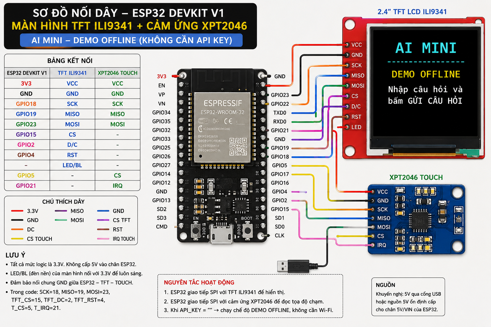

# ESP32 AI Machine: WiFi & API Integration

Welcome to the **ESP32 AI Machine** project. This project demonstrates how to use an **ESP32** microcontroller integrated with AI capabilities, utilizing **WiFi** connectivity to communicate and invoke external **APIs** for smart data processing.

---

## 🚀 Key Features

* **ESP32 Microcontroller:** Compact, low-power, with built-in Wi-Fi and Bluetooth.
* **Wi-Fi Connectivity:** Enables continuous internet connection for real-time data transmission.
* **API Integration:** Sends sensor data or images to Cloud Servers / AI Endpoints via HTTP/HTTPS Requests (REST API).
* **AI/Machine Learning Processing:** 
  * *Edge AI:* Runs lightweight AI models directly on the ESP32 chip (TensorFlow Lite for Microcontrollers).
  * *Cloud AI:* Offloads data via API to powerful cloud AI models (OpenAI, Gemini, custom server) for processing and retrieves the inference results.

---

## 🛠️ Hardware & Software Requirements

### 1. Hardware
* **ESP32 Board** (ESP32 DevKit V1, or camera modules like ESP32-CAM for computer vision AI).
* Peripherals/Sensors (depending on application: temperature sensor, camera, microphone, etc.).
* USB connection cable and jumper wires.

### 2. Software & Tools
* **Arduino IDE** or **ESP-IDF** for C/C++ programming.
* Essential Libraries:
  * `WiFi.h` (Network connection management).
  * `HTTPClient.h` (Handling REST API calls).
  * `TensorFlowLite_ESP32` (For local edge AI deployment).

---

## 🔌 System Workflow

1. **Data Acquisition:** ESP32 captures data from connected sensors or camera modules.
2. **Preprocessing:** Performs local noise filtering or runs a light Edge AI model on-chip.
3. **Connect & Send API Request:** Connects via **WiFi** to push JSON data/results to an external **API**.
4. **Receive Response & Act:** Parses the server response to trigger local hardware actions (e.g., sound an alarm, update OLED display, control motors).

## 🖼️ Preview

